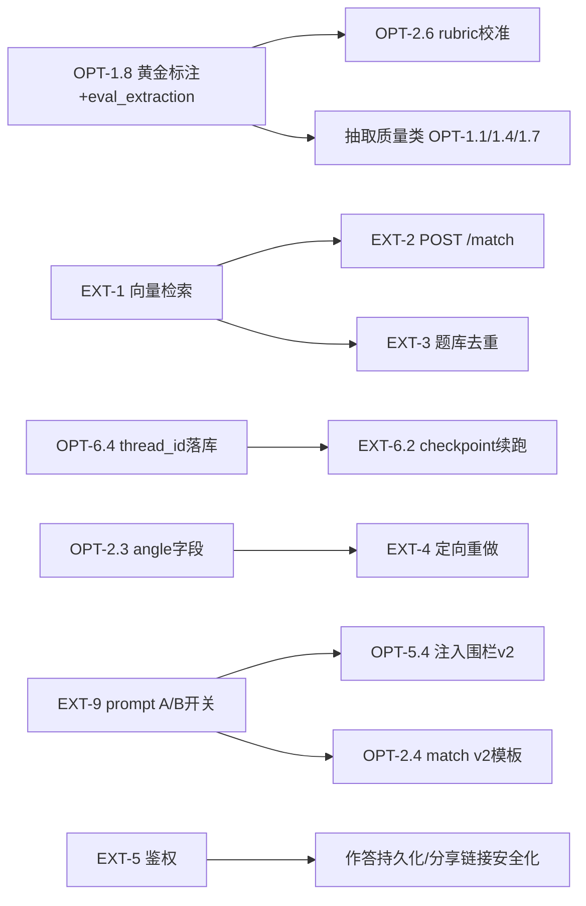

# InterviewForge · 功能优化与扩展蓝图

> 生成日期：2026-10-27。分析依据：`docs/code-wiki/`（01–10 全部专题）、`AGENTS.md`、
> `docs/TODO.md`（里程碑挂账）、`docs/OPTIMIZATION_BACKLOG.md`（2026-10-23 全仓审计）、
> `docs/adr/0007`–`0016`，并核对了 `frontend/`、`app/vectorstore/`、`app/middleware/`、
> `app/utils/` 的当前文件形状。

## 0. 文档定位与分工

仓库里已有两份"账"，本文档**不重复记账**，而是回答"接下来把力气花在哪、按什么顺序"：

| 文档 | 记什么 | 本文与它的关系 |
| --- | --- | --- |
| `docs/TODO.md` | 里程碑挂账，多数**被外部条件卡住**（缺样本/余额/定夺） | 本文引用其编号（§x），把解卡后的方向排进路线图 |
| `docs/OPTIMIZATION_BACKLOG.md` | 缺陷级优化，按 P0→P3 排，**现在就能动工** | 本文引用其编号（P0-x 等），只补"功能级"视角，不重抄条目 |
| 本文档 | **功能域级的优化方向 + 新能力扩展蓝图 + 优先级/依赖/验收** | 面向决策：每个方向给价值、代价、风险、触碰的 ADR/铁律 |

> ⚠️ 时效提示：BACKLOG 的 P3 前端条目（`frontend/app.js` 轮询、`index.html` 导出按钮、a11y）
> 基于 ADR-0016 **之前**的零构建静态页。当前 `frontend/` 已是 Vue 3 + Vite 工程
> （`src/utils/task.ts` 的轮询已可取消），这几条需要按 Vue 源码重新核对后再销账或改写。
> **2026-10-28 已按此重核并改写**（T-305/306/307/308），三条都已销。
>
> ⚠️ §1 那张功能矩阵是 **2026-10-27 的快照**，"缺失"列里有好几格已经在同日及之后的批次里
> 落地了（`angles` 字段 = T-202/ADR-0019、定向重做回路 = T-404/ADR-0021、
> 分页 `total` 与字段投影 = T-303/301/ADR-0020、`export.md` 端点 = T-302/306、
> `thread_id` 落库 = T-304、迁移形状护栏 = T-016、上传上限 = T-002/ADR-0017、
> `TraceStep.ok` = T-008/ADR-0018、`log_level` = T-017、页数上限 = T-208、
> OCR 逐页并发 = T-014）。**现状以 `docs/TASK_PLAN.md` §7 与 `docs/TODO.md` 为准**，
> 本文不重复记账（§0 就是这么分工的），所以那张表不回改。

---

## 1. 现状盘点（功能矩阵）

| 功能域 | 已落地 | 半截 / 预留壳 | 缺失 |
| --- | --- | --- | --- |
| 文件解析 | PDF(PyMuPDF)/DOCX/图片 OCR 分流，扫描件判定 | 扫描件校准（TODO §1 冻结）；OCR 逐页串行 | 页数/体积上限（P2、P0-2） |
| 字段抽取 | 4 抽取器 + 证据铁律，1 次 LLM/简历 | 词典 `unmapped` 无兜底；PDF 断行合并 | 黄金标注集、`eval_extraction.py`（TODO §2） |
| 校验回退 | 5 道规则 + LLM 反思闸门 | 反思问题与规则问题**同通道**（TODO §2.1） | 按字段定向重抽 |
| 匹配/画像/计划 | 确定性缺口、五维 rubric、最大余数配额 | `NullRetriever`（无向量召回）；软要求 >12 条不判 | rubric 真简历校准；`angle` 字段（TODO §2.3） |
| 出题/评审 | Send 扇出、引用闸门、纯批注评审（ADR-0015） | `question_batch` 休眠机制（恒 1） | 定向重做回路（TODO §2.3） |
| 持久化 | 5 表 + repository 铁律 + Alembic | `thread_id` 未落库（P2） | 迁移形状静态护栏（TODO §2.5） |
| API | 13 端点、统一错误体、202+task | 中间件三空壳；`limit` 无约束（P0-3） | 鉴权、分页 total、字段投影、export 端点 |
| 后台任务 | BackgroundTasks + 进度 + 预算护栏 | `mark_failed` 兜底有洞（P1-4/P1-5） | 心跳/回收、checkpoint 续跑入口 |
| 前端控制台 | Vue 3 七页 + 轮询 + Markdown 导出 + 打印 | 草稿仅 localStorage | 作答持久化、报告对比、鉴权 |
| 可观测 | trace/errors 通道、task.progress | `TraceStep.ok` 恒真（P1-3）；`log_level` 不生效（P3） | `GET /metrics`、eval_run 表、Langfuse |
| 向量检索 | `SkillRetriever` Protocol seam | `client/job_indexer/question_dedup` 空壳 | embedding 选型（TODO §3） |
| 安全 | 落盘名防穿越、错误体不回显原文 | 上传无上限（P0-2）、注入围栏仅 2/10 模板（P0-5） | PII 治理（P0-1）、多租户 |

一句话诊断：**主干（解析→生成→落库→展示）已闭环且质量闸门齐全，欠账集中在
"外围工程化"（安全、可靠性、可观测）与"智能增量"（向量检索、重做回路、评测闭环）两条线上。**

---

## 2. 功能优化（按功能域）

编号 OPT-x.y；"来源"列指向已有账目，避免重复立项。

### 2.1 抽取与解析质量（决定整条链的上限）

| # | 优化项 | 价值 | 代价/风险 | 来源 |
| --- | --- | --- | --- | --- |
| OPT-1.1 | **修断行拼接**：`timeline/project_extractor` 的 `"；".join` 把标点插进词中间；PDF 软换行不合并导致证据带半截话 | 高——直接提升证据核对通过率与画像输入质量 | 低——判据设计（行末无标点不补标点）需先拿真简历样本验证 | TODO §2 第 1 条（已有硬证据） |
| OPT-1.2 | **技能等级判据**：`_level_before` 只比起始位置，`熟练运用` 判成 `basic`，且简历侧/JD 侧共用同一判据 | 高——一处比较逻辑，match 缺口档位与 rubric `skill_depth` 同时受益 | 极低——改排序键 `(pos, -len)`，补单测 | BACKLOG P1-1 |
| OPT-1.3 | **重复技能合并**：`_richer` 比 `years`（恒 None）导致永远留第一条 | 中 | 极低——先比 LEVEL_RANK | BACKLOG P1-2 |
| OPT-1.4 | **词典扩充策略**：`SKILL_ALIASES` 硬编码，`unmapped` 只记提示；可选"unmapped 非空时花一次 token 问模型归一" | 中——减少 match 侧花钱问软要求的次数 | 中——新增一次 LLM 调用，须走证据核对铁律 | TODO §2 |
| OPT-1.5 | **`project_extractor` 编号小标题误进 highlights** | 中 | 低——判据：编号开头且句内无动词/逗号 → 开新桶 | TODO §2 |
| OPT-1.6 | **学历别名补 MBA/EMBA/中专/高中**，消掉误报 issue | 低但白送 | 极低 | TODO §2.1 |
| OPT-1.7 | **OCR 层两修**：视觉模型给拉丁字母逐字加空格（`P y t h o n`）导致技能全漏；空白图回元话进 `jd_text` | 中——岗位图片录入链路的实测缺陷 | 中——先量真海报 OCR 形状再选边，改完必须重跑 match 侧判据测试 | TODO §2.6 |
| OPT-1.8 | **黄金标注 + `eval_extraction.py` 出 P/R/F1**——上面所有抽取修改的度量地基 | 高——没有它，任何抽取调参都是自证 | 中——人工标注样本，且**要维护者提供 ≥3 份真简历** | TODO §2/§2.4 |

**建议顺序**：OPT-1.2 → 1.3 → 1.6（三条纯规则小改，不碰契约）→ OPT-1.1 → 1.5 → 1.8 → 其余。

### 2.2 工作流与生成质量

| # | 优化项 | 价值 | 代价/风险 | 来源 |
| --- | --- | --- | --- | --- |
| OPT-2.1 | **validate 问题分家**：规则问题（parse 可修）与反思问题（parse 修不了）走不同计数，回退只对规则问题生效；中期目标演进为"把 issues 当提示**定向重抽被点名字段**" | 高——现状每条规则问题白烧 3 轮完整 parse（TODO 实测），M4 后每个候选人都付费 | 中——改 `route_after_validate` 与 parse 入参约定，**需先定夺再动手**（改 M2 约定） | TODO §2.1 |
| OPT-2.2 | **回退不重读文件**：`raw_text` 已在 state 且文件未变时跳过解析；扫描件不再重跑逐页 OCR | 高——文本省 CPU，扫描件省真金白银 | 低——加 mtime/hash 判据，节点幂等不受影响 | BACKLOG P2-6 |
| OPT-2.3 | **plan 加 `angle` 字段**：同主题多难度档各给考察角度，根治"换皮重复"（实测 4 条批注里 3 条是这类） | 高——题目多样性的正经解法，`roster` 间接手段可退场 | 中——改 `plan.items` 形状，牵动 `focus_topics` 与 ADR-0009 确定性验收，**要新 ADR** | TODO §2.3 |
| OPT-2.4 | **match 模型分支补证据输入**：把 `work_experiences[*].summary` / `projects[*].highlights` 进 prompt（升 v2 模板），否则模型看不见要引用的文本，"钱花了结论丢了" | 高——软要求判定采纳率直接受益 | 低——只动模板与载荷，闸门不变 | BACKLOG P2-8 |
| OPT-2.5 | **软要求分批判定**：`_MAX_UNJUDGED_PER_CALL=12` 之外的永远 `unverified`，且每个 unverified 放大成 focus topic + 出题槽位 | 中 | 低——分批 + gather，注意每批一次调用的成本 | BACKLOG P2-9 |
| OPT-2.6 | **rubric 三张阈值表真简历校准**，动表必升 `RUBRIC_VERSION` | 中——分数可信度的地基 | 中——卡黄金标注（OPT-1.8） | TODO §2.2 |
| OPT-2.7 | **叙述降级门**：输入太薄（维度全中、无缺口）时 profile 不调模型，省固定 1 次调用 | 低 | 低——但要先有单位成本数字（TODO §2.2） | TODO §2.2 |

### 2.3 成本与延迟

| # | 优化项 | 价值 | 代价/风险 | 来源 |
| --- | --- | --- | --- | --- |
| OPT-3.1 | **扇出载荷瘦身**：`source=resume` 槽位不带 `jd_text`、`source=jd` 不带完整 `parsed`；进阶：同主题多档合并一次调用（与 OPT-2.3 联动） | 高——15 题 = 15 份全量上下文，这是最大 token 开销 | 中——**载荷字段不能少**（漏 `jd_text` 曾让引用率掉到 25%）；改前先跑 `eval_e2e.py` 存 token 基线 | BACKLOG P2-1 |
| OPT-3.2 | **重试总时限 + 回灌截断**：两层重试相乘最坏 ~10 分钟；校验重试把完整原始输出塞回对话 | 中 | 低——`asyncio.timeout` 包一层 + 截断 assistant 回灌 | BACKLOG P2-2 |
| OPT-3.3 | **信号量粒度**：acquire 挪进 tenacity 循环，退避睡眠不占并发槽 | 中——上游限流时不再 4 槽全睡觉 | 低——想清楚"每次尝试各占一槽"语义 | BACKLOG P2-3 |
| OPT-3.4 | **`ImageParser` 栅格化进 `to_thread`**（一行）+ **多页 OCR `gather` 并发**（TODO §1 已挂） | 中——大图期间 API 不再停摆；3 页扫描件 3 次串行往返 → 1 轮 | 极低 / 低 | BACKLOG P2-4、TODO §1 |
| OPT-3.5 | **文本 PDF 页数/字数上限** + 三个抽取器共用一份 `SectionMap`（现在每轮跑 3 遍切分） | 低-中 | 极低 | BACKLOG P2-5/P2-7 |
| OPT-3.6 | **`LLMClient.aclose()`**：每请求新建不改（AGENTS.md 铁律），但在依赖收尾/`finally` 关连接池 | 中——长跑进程的句柄稳定性 | 低——`get_llm` 改 async generator 依赖 | BACKLOG P1-6 |

### 2.4 可靠性与任务体系

| # | 优化项 | 价值 | 代价/风险 | 来源 |
| --- | --- | --- | --- | --- |
| OPT-4.1 | **僵尸任务回收**：`running` 超 N 分钟标 `failed` 的清扫入口（CLI 或 `POST /tasks/reap`）；配合 `mark_failed` 兜底纳入 try、补刀失败记 `logger.exception` | 高——现在进程重启/写库失败都会让 task 永远 `running` | 低——单机场景一个定时清扫够用 | TODO §2.4、BACKLOG P1-4 |
| OPT-4.2 | **生成并发去重**：同 `(resume_id, job_id)` 已有 `running` 报告时第二次 POST 返 409（复用 `ConflictError`，`details` 带既有 `interview_id`） | 高——双开 = 两次完整图、几十次上游调用，预算护栏按单运行计拦不住 | 低——判重口径（按 pair 还是按 resume_id）**要维护者定** | BACKLOG P0-6 |
| OPT-4.3 | **"解析中简历被删"报假成功**：`update` 返回 None 时 `mark_failed("resume_gone")` | 中 | 极低 | BACKLOG P1-5 |
| OPT-4.4 | **报告可用性判据显性化**：`task.status=completed` ≠ 报告可用（0 题也是 completed）；把 `finished + total_questions>0 + 批注数` 的读法固化进 `GET /tasks/{id}` 或文档口径 | 中 | 中——契约改动，**要维护者定夺** | TODO §2.4 |
| OPT-4.5 | **409 先查后插的约束兜底**：repository 捕 `IntegrityError` 翻 `ConflictError`（多进程前是约定，之后是防御） | 低（单机 SQLite 单写者眼下安全） | 极低 | TODO §2.5 |
| OPT-4.6 | **迁移形状静态护栏**：`test_migrations.py` 扫 `batch_alter_table` 出现即拒绝——这条铁律曾造成 30 行题目被级联删空的实测事故，不该只靠人记 | 高（数据安全事故的复发防线） | 极低 | TODO §2.5 |

### 2.5 安全与数据治理（先照 BACKLOG P0 销账，这里是功能级视角）

| # | 优化项 | 说明 | 来源 |
| --- | --- | --- | --- |
| OPT-5.1 | 上传大小上限 + 魔数校验（填 `file_handler.py` 空壳，三个上传端点分块读，超限 413/422） | 无上限整份读内存，扩展名可伪造 | BACKLOG P0-2 |
| OPT-5.2 | `limit/offset` 全部过 `Query(ge=1, le=200)` | `LIMIT -1` 实测返回全表 | BACKLOG P0-3 |
| OPT-5.3 | `task.error.details` 键白名单（一处挡住所有节点的路径外泄） | 绝对路径回显给无鉴权客户端 | BACKLOG P0-4 |
| OPT-5.4 | **prompt 注入围栏升 v2**：其余 8 个模板补 `<resume>/<jd>` 围栏 + 不执行指令声明；canary JD 验证评审不被带跑 | JD/简历是用户可控文本，可操纵评审结论 | BACKLOG P0-5 |
| OPT-5.5 | PII 治理包：`reports/` 进 ignore、清 uploads 重复副本、`prune_uploads.py`（dry-run 先行）、真简历去留定夺 | 生成物含真名+手机号且未被忽略 | BACKLOG P0-1、TODO §2.5/§3 |

### 2.6 API 与契约

| # | 优化项 | 价值 | 代价/风险 | 来源 |
| --- | --- | --- | --- | --- |
| OPT-6.1 | **列表字段投影**：`GET /jobs`、`GET /resumes/list` 默认不带 `jd_text`/完整 `parsed`（`?fields=` 或详情端点取正文，**别拆两份 DTO 真相**） | 中——载荷从几百 KB 降到几 KB | 低——前端 4 处用 `.parsed` 要同步 | TODO §2.5、BACKLOG P3 |
| OPT-6.2 | **`GET /interviews/{id}/export.md`**：把 `scripts/export_report_md.py` 挂成端点，控制台直接下载 | 中——消灭"两套分叉的 Markdown 导出" | 低——读端点用 `SessionDep` | BACKLOG P3 |
| OPT-6.3 | 列表加 `total` 与关键词筛选参数（现在前端拉 200 条本地过滤） | 低-中 | 低 | 现状 |
| OPT-6.4 | `interview` 落 `thread_id` 列（裸 `ALTER TABLE`，禁 batch），导出/排障不再扫全 checkpoint | 中 | 低——一条新迁移 | BACKLOG P2-10 |

### 2.7 前端控制台（按 Vue 源码重新核对后修订）

| # | 优化项 | 价值 | 备注 |
| --- | --- | --- | --- |
| OPT-7.1 | 轮询加**指数退避 + 连续失败熔断**（`src/utils/task.ts` 现为固定 2s；BACKLOG 旧条目针对已删除的 `app.js`，需在 Vue 侧重做） | 中 | 保留"可取消"语义 |
| OPT-7.2 | 报告列表页补导出/打印入口（BACKLOG P3 的同类缺口，Vue 版需重新确认 `ReportsView` 是否有） | 低-中 | 与 OPT-6.2 合并做最省 |
| OPT-7.3 | 岗位/简历列表改吃 OPT-6.1 的精简 DTO，详情抽屉再拉正文 | 中 | 与后端联动 |
| OPT-7.4 | 无障碍与文案一致性审计（tabs `role`、错误提示 `role="alert"`、写死文案与常量同源） | 低 | BACKLOG P3 的 Vue 重核版 |

### 2.8 可观测与评测

| # | 优化项 | 价值 | 代价/风险 | 来源 |
| --- | --- | --- | --- | --- |
| OPT-8.1 | **`log_level` 真生效**：lifespan 里按配置 `dictConfig`；顺手决定 logging 中间件（request_id）接线还是删 | 高——现在 `@log_call` 日志一条看不见 | 低 | BACKLOG P3-1 |
| OPT-8.2 | **`TraceStep.ok` 接线**：异常路径补 `ok=False + detail=异常码` 的 trace step，中止运行可归因到节点 | 中 | 低 | BACKLOG P1-3 |
| OPT-8.3 | **`GET /metrics` + `eval_run` 表**：`eval_e2e.py` 的三指标（可用率/幻觉率/换皮重复）落表，端点只读表**绝不现跑评测** | 中——常驻质量仪表盘的地基 | 中——先被余额/样本卡着 | TODO §2.4 |
| OPT-8.4 | checkpoint 库治理：`checkpoints.db` 已 17.9MB 且无清理；按报告完成时间 prune 旧线程 | 低-中 | 低——独立脚本，先 dry-run | BACKLOG P2-10 |
| OPT-8.5 | 空壳模块处置决议：`guardrails/validators/formatters/text/file_handler`、`candidates.py`、死配置键——要么实现要么删，别"广告不存在的功能"（`file_handler` 空壳正是 P0-2 缺口的成因） | 中——消除误导 | 低——**非 git 库删除不可逆，要维护者点头** | BACKLOG P3-2/P3-4 |
| OPT-8.6 | `testing.yaml` 生效或删：conftest 设 `APP_ENV=testing` + 清 `lru_cache`，验证 485 基线不红 | 低 | 中——参数变化可能红一片断言 | BACKLOG P3-3 |

---

## 3. 功能扩展（新能力蓝图）

编号 EXT-n。每条写明**卡点**与**恢复判据**，遵守既有铁律。

### EXT-1 向量检索落地（sqlite-vec + embedding）⭐ 解锁最多下游能力的一条

- **现状**：`SkillRetriever` Protocol + `NullRetriever` 是干净的 seam；
  `client/job_indexer/question_dedup` 三个空壳；`retrieval.*` 配置键大半无人消费（BACKLOG P3-4）。
- **方案**：embedding 选型二选一——(a) `fastembed` 本地跑（契合"内嵌基建、无外部服务"的
  既有决议，零 API 成本，维度固定）；(b) 远端 embedding API（需 `EMBEDDING_*` 四件套配齐）。
  然后实现 `SqliteVecRetriever`，在 `make_match_node(retriever=...)` 注入，**节点代码不动**。
- **收益**：词典外技能名召回（补 `unmapped` 通道）、`source=retrieval` 缺口归因、
  为 EXT-2/EXT-3 提供地基。
- **验收**：`test_match_node.py` 的记录型假库用例换真库跑；三种判据（词典/模型/检索）
  召回率可分别统计，分不开等于没接（TODO §2.2）。
- **卡点**：embedding 选型未决（TODO §3）——**要维护者定夺**。

### EXT-2 岗位适配总览：`POST /match`（阶段 6 遗留）

- 一份简历 × 岗位库 → 按匹配度排序的推荐清单（复用 `match_service` 判据 + EXT-1 召回）。
- **约束**：检索层接上去时**别再引第二本词典**（TODO §2.5）；结果可落一张 `match_run`
  快照表，避免每次重算烧 token。
- **前端**：新增"岗位推荐"视图，点岗位 → 直接进生成工作台。

### EXT-3 题库沉淀与复用

- **现状**：题目落库即终态，跨报告零复用；真去重只有 `review_service` 的字面比对。
- **方案**：
  1. `question` 表加 `topic`/`plan_item` 溯源列（已在 state 载荷里，落库即可）；
  2. 新报告生成前，用 EXT-1 向量核**同岗位历史题**，`question_dedup` 空壳填实
  （`dedup_similarity_threshold` 配置键随之有了消费者）；
  3. 面试官人工"精选/禁用"标记（`curated` 列），精选题进 prompt 的 few-shot 参考。
- **价值**：从"每次从零掷骰"演进为"越用越准的岗位题库"；换皮重复率结构性下降。
- **代价**：中高——涉及新列（裸 ALTER 迁移）、扇出载荷新增字段（AGENTS.md §4 第 8 条：
  点齐才许加）。

### EXT-4 定向重做回路（批注 → 修复，`question_batch` 唤醒）

- **现状**：ADR-0015 拆了质量门，`review_issues` 纯观测；`batch/latest_batch/Overwrite`
  是刻意保留的休眠机制，等的就是这条。
- **方案**：把上一轮被点名槽位的批注装进 `GenerateJob` 载荷（**只给同槽位的旧题**，
  维持分支隔离），`POST /interviews/{id}/redo` 或生成参数 `auto_fix=true` 触发第二轮扇出；
  `latest_batch` 换批落库是现成的。
- **约束**：这是"自动修题的唯一路径"（TODO §2.3），但**不是把 `should_redo` 请回来**——
  新开关是显式授权，不是阈值判定；`test_m5_pipeline.py` 的"一次成卷"断言要随批次数改。
- **前置**：OPT-2.3（angle）先做能减少需要修的题量。需**新 ADR**（编号续 0017+）。
- **已落地 2026-10-28（T-404，决策见 `docs/adr/0021-authorized-targeted-redo-one-round.md`）**。
  上面四条逐条对上，三处与方案文字不同，写清楚：
  ① **"编号续 0017+"是过时的**——0017/0018 已被 S0 用掉、0019 是角度、0020 是列表形状，
  实际编号 **0021**（`docs/TASK_PLAN.md` §3.1 的提示行同步更正）。
  ② **两个触发入口只做了 `auto_fix=true`**：重做一个线程要 `raw_text` 与 `jd_text`，
  而 ADR-0013 的报告头只快照了名字（`job_id` 是 `SET NULL`、简历可删），
  凭 `interview_id` 反查经常拿不到语料；拿不到就静默降级成不带引用的重掷，
  那正是 ADR-0015 打死的东西。`POST /interviews/{id}/redo` 的欠账与两条候选解法见
  `docs/TODO.md` §2.12 第一条。
  ③ **"只给同槽位的旧题"落成白名单**：`GenerateJob.previous` 每条只带
  `stem`/`difficulty`/`source`/`evidence` + 点名它的 `issues`，**不带
  `reference_answer`/`rubric`**（喂旧答案等于请模型抄回去）。
  另外两件方案没提但必须定的事：**批次 2 必须是一份完整卷子**（未点名的题原样带走并
  改写 `batch`，因为 `sort_key` 先比 `batch`、读取端只认 `latest_batch`），
  **回炉边最多一轮**（判据是 `question_batch == 1`，不是 `recursion_limit`）。
  点名判据、号位与"谁被带走"收在 `app/services/redo_service.py` 一处；
  `<previous>` 只由 **v3** 模板渲染（dev 已指 v3，production/testing 仍 v1）。

### EXT-5 多用户与鉴权（阶段 2 欠账，产品化的门槛）

- **方案**：`app/models/user.py` 落地 → JWT 中间件接线（`jwt_secret` 已是必填配置）→
  `resume/job/interview/task` 四表加 `user_id`（新迁移，补 FK）→ 端点按属主过滤 →
  限流先只给 `POST /interviews/generate`（一次几十次上游调用）而非全局。
- **连带**：鉴权后 `task.error` 路径外泄、"知道 id 就能读"的严重度才真正降级；
  前端 `http.ts` 补 token 注入与 401 处理；控制台加登录页。
- **卡点**：属产品决策（单机自用 vs 多租户 SaaS）——**要维护者定夺**。

### EXT-6 任务体系升级（按触发条件分三级，不过度工程）

1. **现在**：OPT-4.1 清扫入口即可（单机 BackgroundTasks 够用）。
2. **要续跑时**：`thread_id` 落库（OPT-6.4）后加"从 checkpoint 恢复线程"入口——
   TODO §2.4 已验证 checkpoint 在独立库里理论可续。
3. **真要并发/多进程时**：任务挪出进程（arq/rq 级别，SQLite 单写者会先成为瓶颈；
   与"内嵌基建"决议冲突时**先立 ADR 再动**）。

### EXT-7 报告形态扩展

- PDF 导出（打印 CSS 已有，服务端渲染可走浏览器打印或引入 weasyprint 级依赖——先量需求）；
- **只读分享链接**（`GET /interviews/{id}/share?token=`，签名 token 免鉴权读，
  在 EXT-5 之前是面试官协作的最小方案）；
- 报告对比视图：同简历不同岗位 / 同岗位不同简历并排 diff。

### EXT-8 面试反馈闭环（数据驱动校准的终点）

- 新表 `interview_feedback`：逐题打分（有用/超纲/换皮）、实际是否问到、候选人表现；
- 反哺三处：rubric 阈值表校准（OPT-2.6）、prompt 版本 A/B（EXT-9）、
  题库精选（EXT-3 的 `curated` 列自动建议）。
- **价值**：把现在"只看不断言"的评测（AGENTS.md §6）升级为有真值标注的闭环。

### EXT-9 Prompt A/B 与评测闭环

- **现状**：版本目录 + trace 版本号归因的机制齐全，但 `registry.py` 宣称的
  `agent.prompt_version` 切换键**不存在**（BACKLOG P3-5）。
- **方案**：把开关补进 `AgentSettings`（yaml 五段之一），配"覆盖生效"测试；
  与 OPT-8.3 的 `eval_run` 表合流：同一简历集 × 两版 prompt → 三指标对比，
  归因链（trace 版本号 → eval_run 行）闭合。
- **价值**：OPT-5.4（注入围栏 v2）、OPT-2.4（match v2）都要升模板版本，
  没有 A/B 机制每次升级都是裸奔。

### EXT-10 输入侧扩展

- **批量上传**：`POST /resumes/upload` 支持多文件（每文件一 task，现有形状直接复用）；
- **JD 结构化录入**：表单分节（职责/要求/加分项）拼 `jd_text`，`split_requirements`
  的栏目识别率天然提高；
- **视觉链路解冻**（TODO §1）：真扫描件样本 + `_MIN_OCR_CHARS/_MAX_SIDE/_JPG_QUALITY`
  三参数实测校准 + 多页并发（OPT-3.4）——代码全就绪，只欠样本与余额。

---

## 4. 优先级与路线图

### 4.1 依赖关系

### 4.2 分阶段路线

| 阶段 | 主题 | 内容 | 外部依赖 |
| --- | --- | --- | --- |
| **S0 止血**（不改任何契约） | 安全与正确性 | BACKLOG P0 全部 + P1 全部；本文 OPT-1.2/1.3/1.6、OPT-2.2、OPT-3.4、OPT-4.1/4.3/4.6、OPT-8.1/8.2 | 无 |
| **S1 质量地基** | 度量先行 | OPT-1.8 黄金标注 → OPT-1.1/1.5/1.7 → OPT-2.6；EXT-9 prompt 开关 + OPT-5.4 围栏 v2 | **维护者：真简历样本、账户充值** |
| **S2 成本与回路** | 生成链精修 | OPT-2.1 回退分家、OPT-2.3 angle（新 ADR）、OPT-2.4/2.5、OPT-3.1/3.2/3.3/3.6、OPT-4.2 并发去重 | OPT-2.1 判据分家要定夺 |
| **S3 契约与体验** | API/前端 | OPT-6.1–6.4、OPT-7.1–7.4、OPT-4.4 可用性判据、OPT-8.3 `GET /metrics`+`eval_run` | OPT-4.4 要定夺 |
| **S4 智能增量** | 新能力 | EXT-1 向量检索 → EXT-2 岗位推荐 → EXT-3 题库 → EXT-4 定向重做（新 ADR） | **维护者：embedding 选型** |
| **S5 产品化** | 多用户 | EXT-5 鉴权+user_id、EXT-6.3 任务出进程评估、EXT-7 分享链接、EXT-8 反馈闭环 | **维护者：单机 vs 多租户定夺** |

> 排序原则：S0 全是"小改动、大代价"（BACKLOG 用法节原话）；S1 先建度量再动质量，
> 否则一切调参自证；S4 排后是因为它依赖选型决策，但**决策可以提前要到**——
> 若维护者先定 embedding，S4 可与 S3 并行。

### 4.3 需要向维护者开口要的东西（集中列）

1. ≥3–9 份真简历样本 + 至少 1 份真人 JD（TODO §2.2/§2.4/§2.6 三条卡在这）；
2. DeepSeek 账户充值（`eval_e2e` 三指标至今没有真实数字，S1/S2 的验收都要它）；
3. 定夺：embedding 选型（fastembed 本地 vs 不做）→ 解锁 EXT-1/2/3；
4. 定夺：validate 反思问题是否退出回退计数（OPT-2.1，改 M2 约定）；
5. 定夺：并发去重按 `(resume_id, job_id)` 还是按 `resume_id`（OPT-4.2）；
6. 定夺：`task=completed` 但 0 题要不要报成可见降级态（OPT-4.4）；
7. 定夺：多租户产品方向（EXT-5/6.3/7/8 整组的开关）；
8. 点头：删除空壳模板/模块/文件（非 git 库不可逆，OPT-8.5、TODO §2.2 `plan.*.j2`）。

---

## 5. 落地约束（每条改动前重读）

1. **分层铁律**（AGENTS.md §3）：`api → services → repositories`；repository 只 flush；
   节点不直连库；LLM 全走 `LLMClient` 装配期注入。
2. **节点契约**（AGENTS.md §4）：只返回增量；累积通道 `[新元素]`/`Overwrite`；
   `GenerateJob` 载荷字段必须点齐（EXT-3/4 新增字段时尤其）；回退路由 `<=`。
3. **迁移形状**（ADR-0013）：加 NOT NULL 列一律裸 `ALTER TABLE … DEFAULT`，
   **禁 `op.batch_alter_table`**；新模型登记 `models/__init__.py`；`alembic.ini` 纯 ASCII。
4. **抽取铁律**（AGENTS.md §5）：无证据即丢弃；出题与评审共用同一引用判据
   （`question_service.verify_evidence`）——EXT-1 接入时**不许出现第二本词典/第二套判据**。
5. **测试策略**（AGENTS.md §6）：不断言 LLM 文案；新能力先假件/录制回放，
   质量指标只看不断言；基线 485 passed / ruff / mypy 三绿不许红。
6. **前端**（ADR-0016）：只动 `frontend/src/` 并重新构建；判断留服务端；不引 `v-html`；
   DTO 改动同步 `src/api/types.ts` + `npm run typecheck`。
7. **ADR**：OPT-2.3（angle）、EXT-4（重做回路）、EXT-5（鉴权）、EXT-6.3（任务出进程）、
   EXT-1（embedding 选型）各需一条新 ADR，编号从 **0017** 续。
8. **文档卫生**：BACKLOG P3 的前端条目按 Vue 源码重核；`README.md`/`project_structure.md`
   的 Postgres/Celery 过时描述在动它们之前顺手改掉（TODO §3 已挂）。

## 6. 验收口径

- **每个阶段合入前**：三条质量门全绿 + 动了前端加 typecheck + 动了模型加 `alembic check`。
- **质量类改动（S1/S2/S4）**：以 `scripts/eval_e2e.py` 三指标（可用率↑、幻觉率=0、
  换皮重复↓）与 `question_service.evidence_ratio`（基线 100%，不许掉）为准；
  改扇出/载荷前先存 token 基线，改后对比（BACKLOG 用法节第 3 条）。
- **可靠性类（S0/S3）**：注入故障用例（写库失败、解析中删行、双开 POST、大图并发）
  的 task/interview 终态断言，照 AGENTS.md §6 只断结构。
- **销账纪律**：做完的条目回 `TODO.md` / `OPTIMIZATION_BACKLOG.md` 勾 `- [x]` 并补一行
  实测结论，本文只更新矩阵与路线图，不留第二份真相。
