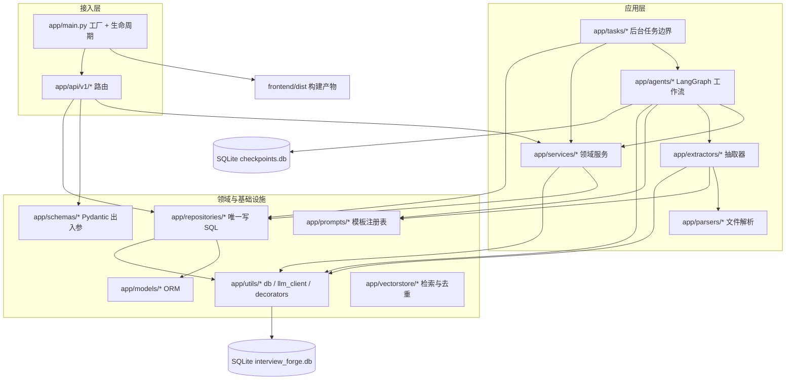
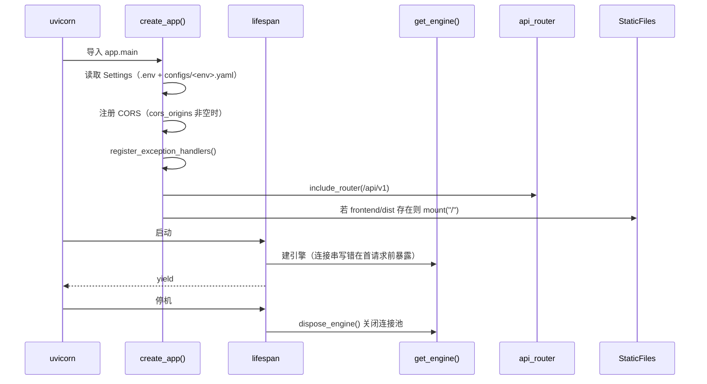
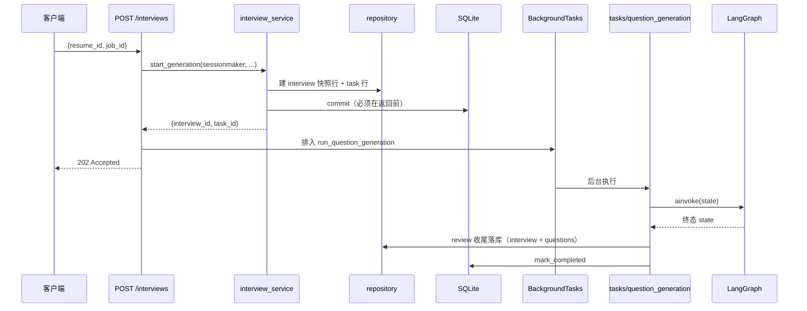

# 01 · 整体架构

## 1. 分层视图

项目遵循严格的单向依赖：**`api → services → repositories`**，节点与抽取器通过装配期注入
拿依赖，不直接连库。



### 各层职责与禁止事项

| 层 | 职责 | 禁止 |
| --- | --- | --- |
| `app/api/v1/` | HTTP 入参校验、状态码、调用 service | `import app.models`；写 SQL |
| `app/services/` | 业务编排、规则判定、事务边界（后台任务场景） | 写 SQL；自己 `new LLMClient` |
| `app/repositories/` | 唯一写 SQL 的地方；只 `flush` 不 `commit` | `commit`；抛 `NotFoundError`（404 是 API 语义） |
| `app/agents/` | LangGraph 节点：读 state → 写增量 | 直连数据库；返回整个 state |
| `app/extractors/` | 正则/词典优先的字段抽取 + 证据核对 | 无证据的值入库；让模型判断日期 |
| `app/models/` | SQLAlchemy ORM 定义 | `relationship()`；隐式表名 |
| `app/utils/` | 引擎、LLM 客户端、通用工具 | 反向依赖 web 层 |

> 规则来源：仓库根 `AGENTS.md` §3「分层铁律」。

## 2. 应用启动生命周期

入口是 [`create_app()`](file:///d:/code/InterviewForge/app/main.py#L61-L87)（工厂而非模块级对象，
测试可反复建 app 而不共享 lifespan 状态）。模块级 `app = create_app()` 供 `uvicorn app.main:app` 使用。



关键顺序约束：

1. **静态目录必须最后挂载**。Starlette 按注册顺序匹配，`/` 上的 `StaticFiles` 排前面会吃掉
   `/api/v1/...`。
2. **`FRONTEND_DIST.is_dir()` 保护**。缺目录时 `StaticFiles(check_dir=True)` 会让 `create_app()` 直接抛错。
3. **lifespan 启动即 `get_engine()`**，把连接串错误挡在第一条请求之前。

## 3. 配置体系

[`app/config.py`](file:///d:/code/InterviewForge/app/config.py) 用 pydantic-settings 合成唯一 `Settings`，
优先级从高到低：

```
构造参数 > 进程环境变量 > .env（密钥/连接串）
        > configs/<APP_ENV>.yaml（行为参数） > 代码默认值
```

- 只应通过 `get_settings()` 获取（`lru_cache` 单例）。直接 `Settings(...)` 可能让行为参数来自
  另一套环境的 yaml；`get_settings()` 会校验 `APP_ENV` 与 yaml 内 `app.env` 一致。
- YAML 只允许 `app` / `llm` / `agent` / `question` / `retrieval` 五段，出现未知段直接报错。
- 密钥只进 `.env`（已 gitignore），永不复述给维护者。

详见 [08-configuration.md](./08-configuration.md)。

## 4. 依赖注入（装配期）

[`app/dependencies.py`](file:///d:/code/InterviewForge/app/dependencies.py) 只做装配，不做业务。

| 依赖别名 | 产出 | 生命周期 | 使用场景 |
| --- | --- | --- | --- |
| `SessionDep` | `AsyncSession`（经 `session_scope`） | 每请求一个事务 | 纯读端点、同步写端点 |
| `SessionMakerDep` | `async_sessionmaker` | 进程级工厂 | **会唤起 `BackgroundTasks` 的写端点** |
| `LLMDep` | `LLMClient` | **每请求新建、不缓存** | HTTP 侧调用 LLM |
| `get_engine()` | `AsyncEngine` | 进程级单例（按 URL 缓存） | 脚本/后台任务/API 共用 |
| `get_sessionmaker()` | 会话工厂 | 不缓存（薄封装） | 脚本、后台任务 |

为什么这样设计：

- **引擎必须单例**：两台引擎就是两套连接池抢同一个 SQLite 文件（单写者）。
- **LLM 客户端不能单例**：内部的 `Semaphore` 与 `UsageTotals` 是「一次运行」的量纲，
  单例会跨请求累加用量，成本护栏就失去意义。
- **后台任务端点用 `SessionMakerDep`**：实测 FastAPI 0.143 + Starlette 1.8 的执行顺序是
  `dep-enter → endpoint → background → dep-exit`，后台协程跑在 `get_db` 提交**之前**。
  这类端点必须由服务层用 `session_scope` 自己提交（ADR-0011）。

## 5. 一次写请求的链路（以「生成报告」为例）



要点：
- **报告头快照**（简历名/文件名、岗位名/公司）在 `start_generation` 写死，之后不回写源表。
- **任务边界吞掉一切异常**并落进 `task` 行（`mark_failed`），后台协程抛出去没人接。
- **成本护栏在 `generate` 扇出前**读 `llm.usage` 累计用量，越线抛 `BudgetExceededError`（429）。

## 6. 错误处理

[`app/exceptions/base.py`](file:///d:/code/InterviewForge/app/exceptions/base.py) 定义异常层级，
[`handlers.py`](file:///d:/code/InterviewForge/app/exceptions/handlers.py) 统一响应体：

```json
{"error": {"code": "...", "message": "...", "details": {}}}
```

| 异常 | HTTP | code | 语义 |
| --- | --- | --- | --- |
| `NotFoundError` | 404 | `not_found` | 资源不存在 |
| `ValidationFailedError` | 422 | `validation_failed` | 规则/Schema 校验失败 |
| `ParseError` | 422 | `parse_failed` | 文件读不出文本 |
| `ConflictError` | 409 | `already_exists` | 自然键撞车（如岗位 title+company） |
| `LLMError` | 502 | `llm_error` | 上游模型网络/超时/限流/配额 |
| `LLMResponseError` | 502 | `llm_response_invalid` | 模型通了但 JSON/结构不可用 |
| `BudgetExceededError` | 429 | `cost_budget_exceeded` | 单次运行 token 预算耗尽 |

三条边界：未预期异常一律 500 + 固定文案（堆栈只进日志）；`RequestValidationError` 只保留
`loc`/`msg`（避免回显简历原文）；`details` 由抛出方构造且不得含密钥。

## 7. 前端托管与 SPA 回退

[`_SpaStaticFiles`](file:///d:/code/InterviewForge/app/main.py#L40-L58) 只对**导航请求**回退到
`index.html`：

- 静态 404 且路径不以 `api/` 开头且最后一段不含 `.` → 返回 `index.html`；
- `/api/v1/typo`、缺失的 `/assets/*.js` 继续 404，避免把接口错误伪装成页面；
- Windows 上 `get_path` 会给出反斜杠，判形前统一成正斜杠。

## 8. 必须守住的不变量

1. 一个进程只有一台异步引擎；repository 只 `flush`，提交在 `session_scope`。
2. 节点只返回增量；只追加通道（`trace`/`errors`/`questions`）返回 `[新元素]`。
3. 所有 LLM 调用经 `LLMClient`，节点/抽取器不自行实例化。
4. 任何抽取值必须能在原文中逐字找到证据；找不到就丢弃并记 `notes`。
5. 日期/年限/区间判断只走确定性规则层，绝不交给模型。
6. 新增 ORM 模型必须登记进 `app/models/__init__.py`，否则 autogenerate 会产出空迁移。
7. 前端只读 `frontend/dist/`；源码改动必须重新构建。
8. `alembic.ini` 只能是 ASCII；迁移不得使用 `op.batch_alter_table`（会触发级联删除）。
