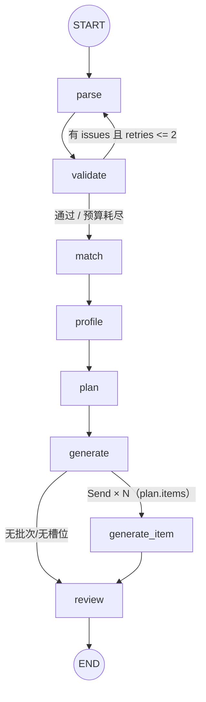

# 02 · LangGraph 工作流与节点

工作流是项目的核心：把一份简历与一份 JD 加工成一份结构化面试卷。装配代码在
[`app/agents/workflow.py`](file:///d:/code/InterviewForge/app/agents/workflow.py)，
状态定义在 [`app/agents/state.py`](file:///d:/code/InterviewForge/app/agents/state.py)，
节点实现在 `app/agents/nodes/`。

## 1. 图结构



- **唯一回退边**是 `validate → parse`（ADR-0015 删掉了 `review → generate`）。
- `generate_item` 是扇出工作节点，不在主干 `PIPELINE` 里；一次运行派几个由 `plan.items`
  决定。
- `generate` 的两个「不扇出」出口都有真实调用方：`question_batch` 为 0（骨架测试占位）、
  槽位为空（plan 没给配额）。

装配入口：

```python
build_agent_graph(
    nodes: Mapping[NodeName, Node | FanoutNode],
    *,
    checkpointer: AsyncSqliteSaver | None = None,
    wrap_nodes: bool = True,
)
```

缺少 `GRAPH_NODES` 中任何实现都会在**装配期**抛 `ValueError`，而不是运行到一半才炸。
主干节点默认被 `traced()` 包装；`generate_item` 不包（一次批次派 N 份，全写 trace 会淹没
「七个阶段」的观测面）。

## 2. AgentState 通道

[`AgentState`](file:///d:/code/InterviewForge/app/agents/state.py#L66-L109) 是 `TypedDict(total=False)`：
节点只返回自己写的键，未写的沿用上一个 checkpoint。

| 通道 | 类型 / reducer | 写入者 | 说明 |
| --- | --- | --- | --- |
| `resume_id` | `str` | 调用方 | 简历行 id |
| `jd_text` | `str` | 调用方 | 岗位 JD 原文 |
| `interview_id` | `str` | 调用方 | 报告头 id；缺省时 review 跳过落库 |
| `raw_text` | `str` | `parse` | 文件解析出的纯文本 |
| `parsed` | `dict \| None` | `parse` / `validate` | `ResumeSchema` 序列化结果 |
| `validate_issues` | `list[str]` | `validate` | 驱动回退门的问题清单 |
| `validate_retries` | `int` | `validate` | **节点自增**，路由用 `<=` 比较 |
| `matched_gaps` | `list[dict]` | `match` | 岗位要求 vs 简历的缺口清单 |
| `profile` | `dict` | `profile` | 画像：分数、主题、叙述 |
| `plan` | `dict` | `plan` | 配额表 `items` |
| `questions` | `Annotated[list, operator.add]` | `generate`（`Overwrite([])`）/ `generate_item` | **累积通道** |
| `question_batch` | `int` | `generate` | 批次号，`generate` 自增 |
| `review_issues` | `list[dict]` | `review` | 纯观测批注，覆盖语义 |
| `finished` | `bool` | `review` | 收尾标记 |
| `trace` | `Annotated[list, operator.add]` | `traced()` | 每步耗时 + prompt 版本 |
| `errors` | `Annotated[list[str], operator.add]` | 各节点 | 只追加流水账，无机器后果 |

### 节点契约（违反即返工）

1. **只返回增量**，绝不返回整个 state，绝不原地修改入参。
2. **只追加通道**（`trace` / `errors` / `questions`）返回 `[新元素]`；返回整列表会冲掉历史。
3. **prompt 必须走 registry 且带版本号**：节点返回保留键 `"prompt_version"`，
   `traced()` 会 `pop` 掉并写进 `TraceStep`，它不是 state 通道。
4. **可恢复失败**写 `issues`/`errors` 并让路由处理；**不可恢复失败**抛 `AppError` 子类，
   不允许 `except` 后静默返回空结果。
5. **回退路由用 `<=`**：计数先自增，`validate_max_retries=2` = parse 最多额外重做 2 次（共 3 次）。
6. **节点必须幂等**：回退/重放不得产生重复数据；落库只在 `review` 收尾且只写一次。
7. 每个 LLM 调用声明 token 预算（`settings.llm.default_max_tokens`），不裸调。
8. 扇出分支看到的是 `GenerateJob` 载荷，不是主图 state。
9. 批注的采纳判据只写一处：`review_service.adopt_model_issues`。

## 3. 节点逐个说明

### 3.1 `parse` — 文件 → 结构化简历

[`nodes/parse_node.py`](file:///d:/code/InterviewForge/app/agents/nodes/parse_node.py)

- 工厂：`make_parse_node(*, llm, registry, settings, upload_dir)`。
- **输入**：`resume_id`。
- **流程**：
  1. `locate_resume_file()` 按 `<upload_dir>/<resume_id><扩展名>` 找原件；非法 id 抛
     `ValidationFailedError`，找不到抛 `NotFoundError`。
  2. `_read_document()`：图片后缀走 async `ImageParser`；PDF/DOCX 用 `asyncio.to_thread`
     调同步 `ParserRegistry`（CPU 密集，不阻塞事件循环）；PDF 报 `parse_scanned_image`
     时转视觉路径。
  3. 四个抽取器：`NerExtractor`（唯一花 LLM 的一步）、`extract_timeline`、
     `extract_skills`、`extract_projects`（纯规则）。
  4. `_years_reconciliation()`：自称年限与时间线复算值差超过 `YEARS_TOLERANCE` 时记一条
     `errors`，`parsed` 取时间线的值。
  5. 字段过 `ResumeSchema.model_validate`；不合格抛 `ValidationFailedError`。
- **输出**：`{raw_text, parsed, errors, "prompt_version": "ner@v1[+ocr@v1]"}`。
- 必填的 `years_experience` 没着落时按 `0.0` 占位并记流水账，让校验层判成色。

### 3.2 `validate` — 规则先行，LLM 反思

[`nodes/validate_node.py`](file:///d:/code/InterviewForge/app/agents/nodes/validate_node.py)

- 工厂：`make_validate_node(*, llm, settings)`。
- **规则层**：`resume_service.validate_resume(raw_text, parsed)` 返回
  `outcome.issues / parsed（可能修复）/ repairs`。
- **只有规则全过**才调 LLM 反思（省 token）；反思结果只保留**点名了已知字段**的条目
  （`_KNOWN_FIELDS = ResumeSchema.model_fields`）。
- 反思调用失败（`LLMError`/`LLMResponseError`）→ 返回空问题，不拦流程。
- **输出**：`validate_issues`、`validate_retries`（有问题才 +1）、修正后的 `parsed`、
  `errors`、可选 `prompt_version`。
- 路由：`route_after_validate` 在 `validate_issues` 非空且 `validate_retries <= validate_max_retries`
  时回 `parse`。

### 3.3 `match` — 词典对齐 + 软要求模型判定

[`nodes/match_node.py`](file:///d:/code/InterviewForge/app/agents/nodes/match_node.py)

- 工厂：`make_match_node(*, llm, retriever, settings)`；默认 `retriever=NullRetriever()`。
- 前置条件：`parsed` 与 `jd_text` 缺一不可，否则抛 `ValidationFailedError`。
- **规则层**：`match_service.build_match(jd_text, parsed)` 产出确定性缺口。
- **模型只判 `result.unresolved`**（词典无解的软要求），一次最多 12 条
  （`_MAX_UNJUDGED_PER_CALL`）；模型给的证据必须在 `raw_text` 逐字找到，否则
  `adopt_llm_gaps` 降级/丢弃。
- 模型没接住的要求以 `unverified` / `source=unjudged` 进清单——它们是「没依据」，
  不是「JD 没这条要求」。
- **输出**：`matched_gaps`、可选 `errors`、可选 `prompt_version`。
- 幂等：`build_match` 是纯函数。

### 3.4 `profile` — 分数由 rubric，模型只写叙述

[`nodes/profile_node.py`](file:///d:/code/InterviewForge/app/agents/nodes/profile_node.py)

- 工厂：`make_profile_node(*, llm, settings)`。
- **分数与主题确定性**：`profile_service.score_dimensions` / `derive_focus_topics` /
  `confidence_from_signals`，`RUBRIC_VERSION` 写进画像。
- **模型叙述**经闸门：每条 strength/weakness 必须点名已知实体（维度名、主题名、技能名、
  项目名），否则丢弃；summary 长度不在 `[2, 200]` 时用规则版。
- 模型自评 confidence 只当上限；规则版兜底。
- **输出**：`profile = {rubric_version, candidate, dimensions, focus_topics, summary,
  strengths, weaknesses, confidence, narrative_source}`。

### 3.5 `plan` — 纯确定性配额表（不调 LLM）

[`nodes/plan_node.py`](file:///d:/code/InterviewForge/app/agents/nodes/plan_node.py)

- 工厂：`make_plan_node(*, settings)`。
- `difficulty_quotas(total, ratio)`：**最大余数法**，保证各档之和 == total 且每档偏差 < 1；
  平局按 `easy → medium → hard`。
- `allocate(topics, quotas)`：按 `focus_topics` 顺序（弱项在前）轮流发牌，同档内不打乱。
- `items` 每条含：`topic / difficulty / count / dimension / source / evidence / rationale`。
- `source` 只有 `resume / jd / generic` 三档；没主题时用「综合考察」兜底并记 `errors`。
- **输出**：`plan = {total, difficulty_quotas, strategy: "weak_first", topic_count,
  rubric_version, items}`。

### 3.6 `generate` — 扇出准备（不调模型）

[`nodes/generate_node.py`](file:///d:/code/InterviewForge/app/agents/nodes/generate_node.py#L57-L93)

四个动作：

1. **成本护栏** `_require_budget`：`llm.usage` 的 prompt+completion 合计 ≥
   `agent.max_tokens_per_run` → 抛 `BudgetExceededError`（429）。这是全图最大一笔开销之前
   唯一的刹车点。
2. `question_batch += 1`。
3. `questions: Overwrite(value=[])` 清空累积通道（同一超步只许一个 `Overwrite`）。
4. 声明 `prompt_version = generate@v1` 并记一条 `errors` 流水账。

没有配额 → `ValidationFailedError("generate_no_plan")`。

### 3.7 `generate_item` — 扇出分支

[`nodes/generate_node.py`](file:///d:/code/InterviewForge/app/agents/nodes/generate_node.py#L96-L137)

- 工厂：`make_generate_item_node(*, llm, settings)`。
- **输入是 `GenerateJob`**（见下节），一条槽位一次 `chat_json`，温度 `0.3`（出题需要一点多样性）。
- `adopt_questions()` 做逐题闸门：字段完整、引用可回溯、序号按 `order_start` 落位。
- 可恢复失败：模型坏了 → 返回 `errors`，本槽位 0 题，**不拖垮其他分支**；
  差额由 `review` 记录成批注。
- **输出**：`questions: [新增题目]` + 可选 `errors`。

### 3.8 `review` — 规则 + 语义批注，收尾落库

[`nodes/review_node.py`](file:///d:/code/InterviewForge/app/agents/nodes/review_node.py)

- 工厂：`make_review_node(*, llm, settings, sessionmaker)`。
- **ADR-0015：不拦门**。状态恒 `completed`，题目照常落库。
- 规则层 `rule_issues(questions, raw_text, plan, jd_text)` 先判整批（数量、引用、结构等）；
  规则有问题**不短路**语义评审——空批次例外。
- 语义评审 `adopt_model_issues` 丢弃越界序号、空正文、同题同话。
- 评审调用失败 → 吞成一条 `index=None` 的规则层批注 + `errors`；题目照落。
- `persist_report(sessionmaker, interview_id, ...)` 一次性写 `interview` 更新 + N 行 `question`
  （同一事务）；缺 `sessionmaker` 或 `interview_id` 时跳过落库并记流水账。
- **输出**：`review_issues`、`finished=True`、`errors`、可选 `prompt_version`。

## 4. GenerateJob：扇出载荷

[`GenerateJob`](file:///d:/code/InterviewForge/app/agents/workflow.py#L29-L55) 是分支能看到的**全部输入**：

| 字段 | 用途 |
| --- | --- |
| `plan_item` | 本条槽位：`topic / difficulty / count / source / evidence` |
| `order_start` | 本槽位在整卷的起始序号（按前面 `count` 的计划值累加） |
| `question_batch` | 批次号 |
| `raw_text` | 简历原文（`source=resume` 引用核对） |
| `jd_text` | JD 原文（`source=jd` 引用核对；漏给会让 JD 题引用率骤降） |
| `roster` | 其他槽位的摘要（topic/difficulty/count），用于避免同主题各档撞题 |
| `parsed` | 结构化简历 |

> 实测（langgraph 1.2.15）：分支收到的是 `Send` 载荷本身，不是「主图 state + 载荷」。
> 漏一个通道，那一类题就永远拿不到依据。见 `scripts/probe_send_fanout.py`。

## 5. trace、checkpoint 与线程

- `make_thread_config(thread_id=None, recursion_limit=None)` 生成 `RunnableConfig`；
  `thread_id` 决定 checkpoint 归属，默认 `uuid4().hex`。
- checkpoint 独立成 `data/checkpoints.db`（`AsyncSqliteSaver`），与业务库分离。
- `traced(name, node)` 记录 `{node, ok, ms, detail?, prompt_version?}` 到 `trace`；
  失败时只重抛不写 state（LangGraph 节点无法既返回更新又抛异常），异常由调用方记录。

## 6. 当前 prompt 模板

`app/prompts/templates/v1/`：

| 节点 | 模板 |
| --- | --- |
| parse | `parse.system.j2` / `parse.user.j2` |
| validate | `validate.*` |
| match | `match.*` |
| profile | `profile.*` |
| plan | `plan.*` |
| generate | `generate.*` |
| review | `review.*` |
| NER 抽取 | `ner.*` |
| 图片 OCR | `ocr.*` |
| 岗位图片字段 | `job_fields.*` |

取模板：`get_prompt(node, version="v1")`；环境固定 `autoescape=False` + `StrictUndefined`。
新增一版 = 复制版本目录，节点代码不动，只换 `version`，这样 trace 里的版本号能归因。

## 7. 为什么这样拆（决策摘要）

- **确定性优先**：match/profile/plan 的分数、配额、排序全部由规则给，模型只补「无解的
  软要求」和「被闸门过滤的叙述」。模型抖动不会改变卷子的骨架。
- **一次成卷**：ADR-0015 之后没有「评审不过就重做」。原因是重做时 `GenerateJob` 不带上一轮
  批注，等于盲重掷；宁可少几题、多几条批注，也不烧两遍 token 后把整份卷子判成 0 题。
- **扇出而非一次出 15 题**：`default_max_tokens=2048` 装不下整卷；单条 JSON 破损会让整批归零，
  扇出后只影响一个槽位。
