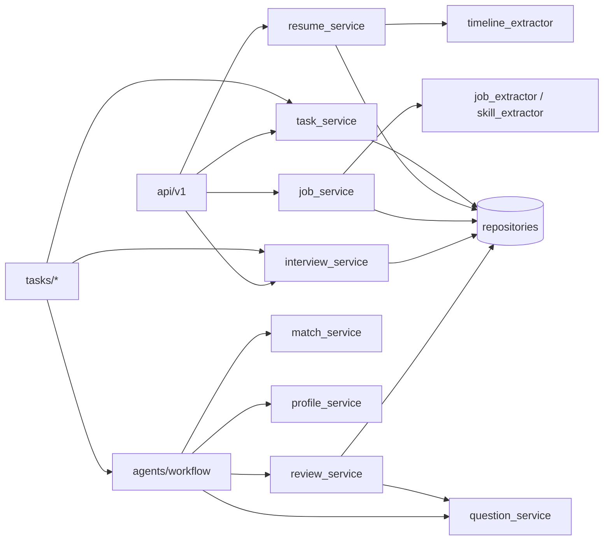

# 04 · 领域服务层

`app/services/` 是「节点与 API 之间的业务中间层」：**不写 SQL，不碰 ORM 查询细节**，
所有持久化经 repository；规则判定尽量写成纯函数，便于单测。

| 模块 | 角色 | 是否碰库 |
| --- | --- | --- |
| `resume_service.py` | 简历规则校验 + 上传受理 + 简历 CRUD | 部分（上传/删除） |
| `job_service.py` | 岗位 CRUD、JD 文件解析、图片录入草稿 | 部分（CRUD） |
| `match_service.py` | JD 要求拆分、技能对齐、缺口构造与模型回收 | 否 |
| `profile_service.py` | 五维 rubric 打分、主题推导、置信度、兜底叙述 | 否 |
| `question_service.py` | 出题闸门：引用核对、草稿收口、工序号、报告顺序 | 否 |
| `review_service.py` | 整批规则批注、模型批注收口、**唯一落库出口** | 是（`persist_report`） |
| `interview_service.py` | 开跑一次生成、读回报告、列表 | 是 |
| `task_service.py` | 任务行的建/读/进度/终态 | 是 |

---

## 1. `resume_service` — 校验与简历生命周期

### 1.1 规则校验：`validate_resume(raw_text, parsed, *, today=None)`

返回 [`ValidationOutcome`](file:///d:/code/InterviewForge/app/services/resume_service.py#L49-L55)：

```python
@dataclass(frozen=True)
class ValidationOutcome:
    parsed: dict[str, Any]      # 修好的副本（入参不被改动）
    issues: tuple[str, ...]     # 判罚 → 驱动 validate → parse 回退
    repairs: tuple[str, ...]    # 已自动修好的说明
```

五道检查：

| 检查 | 行为 | 归属 |
| --- | --- | --- |
| `_prune_without_evidence` | 对 `skills / educations / work_experiences / projects` 逐条跑 `evidence_belongs`，找不到出处的条目直接删 | `repairs` |
| `_check_required` | 姓名非空、`years_experience` 是数字 | `issues` |
| `_check_date_order` | 只看 `TimelineResult.dropped` 里 `reason=inverted` 的区间（倒挂进不了 `parsed`） | `issues` |
| `_check_degree_enum` | 学历值必须在 `Degree` 枚举；归到 `other` 但原文有学历字样 → 提示别名表漏收 | `issues` |
| `_reconcile_years` | 时间线复算年限，差超过 `YEARS_TOLERANCE=1.0` 判 issue；原先是 0 占位则直接补 | `issues` / `repairs` |

> 校验层是回退路由的唯一输入，因此必须是纯函数、确定性、零成本。

### 1.2 上传受理：`accept_upload(sessionmaker, *, file_name, data, settings=None)`

- 校验后缀（`allowed_suffixes`）：PDF/DOCX 恒可；图片仅在 `llm_model_vision` 已配置时受理。
- 落盘名固定 `{resume_id}{suffix}`，**用户文件名不参与路径构造**（防穿越/覆盖），
  原名只进展示列（截 255）。
- `asyncio.to_thread(write_bytes)` 避免阻塞事件循环。
- 在一个 `session_scope` 内建 `resume` + `task(pending)` 两行并**当场提交**——后台任务
  在 `get_db` 收尾前就开跑，必须能读到行。

### 1.3 其余 API

| 函数 | 说明 |
| --- | --- |
| `fetch_resume(session, id)` / `list_resumes(session, limit, offset)` | 读 |
| `rename_resume(session, id, name)` | **只改展示名**；`raw_text` / `parsed` 是证据链真相源，不开写入口 |
| `delete_resume(session, id, *, force=False)` | 名下有报告先 409；`force=true` 才级联删。文件在行删除**之后**删且忽略失败 |

`delete_resume` 的顺序很重要：先删文件再回滚会造出「库里有、盘上没有」的坏行；反过来只留
一个孤儿文件占盘。

---

## 2. `job_service` — 岗位与 JD 受理

### 2.1 技能派生：`derive_required_skills(jd_text)`

- 逐行跑 `skill_mentions_in`（与 `match` 共用同一本 `SKILL_ALIASES` 词典）。
- 输出小写正名、按出现顺序去重。
- **用户显式给的清单优先**（`_normalize_skills` 只做小写归一与去重），不补不删。

### 2.2 JD 文件：`read_jd_file(*, file_name, data)`

- 支持 `.txt` / `.md` / `.pdf` / `.docx`。
- 文本先 `utf-8-sig` 再 `gb18030`（本机记事本默认 GBK）；都失败抛 `jd_encoding_unknown`。
- PDF/DOCX 还原到临时目录，用 `ParserRegistry([PdfParser(), DocxParser()])` 同步解析，
  两次 IO 都丢线程池；**不落盘**（岗位没有「稍后再解析」阶段）。

### 2.3 CRUD

| 函数 | 要点 |
| --- | --- |
| `create_job(session, payload)` | 先查 `get_by_title_and_company`，撞自然键抛 `ConflictError`（带 `details.job_id`） |
| `create_job_from_upload(...)` | 读文件 → `create_job`；表单字段在服务层补长度校验（避免冒成 500） |
| `update_job(session, id, payload)` | 改 `title/company` 时重新查重；改 `jd_text` 且未给技能 → 重新派生 |
| `delete_job(session, id)` | 报告保留（`interview.job_id` 为 `ON DELETE SET NULL`，快照列仍在） |
| `list_jobs` / `get_job` | 读；找不到返回 `None` |

### 2.4 图片录入：`draft_job_from_image(*, file_name, data, llm)`

- 临时文件 → `ImageParser(llm=llm).parse(path)`（视觉模型 OCR）。
- `JobFieldExtractor(llm=llm).extract(jd_text)` 先规则后模型。
- 返回 `JobDraftOut`：`title / company / jd_text / required_skills / min_years /
  missing_required / notes`。
- **不落库、不查库、不留原件**：草稿由人确认后走 `POST /jobs`，409/422 语义与普通建岗一致。

---

## 3. `match_service` — 确定性缺口判定

### 3.1 数据结构

```python
GapLevel = Literal["matched", "partial", "missing", "unverified"]
SectionName = Literal["required", "preferred", "duty"]

@dataclass(frozen=True)
class Requirement:
    text: str                 # JD 原文逐字片段（空白折叠）
    section: SectionName
    mentions: tuple[SkillMention, ...]

@dataclass(frozen=True)
class MatchResult:
    gaps: list[dict]
    unresolved: tuple[Requirement, ...]   # 词典无解，交模型
    notes: tuple[str, ...]
    requirements: tuple[Requirement, ...]
```

### 3.2 拆分：`split_requirements(jd_text)`

- 拆分符 `；;，,。：:\n`。**顿号 `、` 刻意不拆**：`熟悉 MySQL、PostgreSQL` 拆开会丢掉
  「熟悉」这个程度词。
- 先识别栏目标题（加分项 → `preferred`；岗位职责 → `duty`；任职要求 → `required`），
  标题本身不算要求项。
- 短于 4 字的残句丢弃；`squeeze` 后去重。

### 3.3 对齐：`build_match(jd_text, parsed)`

- `duty` 段跳过（记 note）；无词典技能名的要求进 `unresolved`。
- 每个技能一条缺口，按严重度留最严重：`missing(0) < partial(1) < unverified(2) < matched(3)`。
- 判档规则：简历没有 → `missing`；JD 没写程度 → `matched`；简历程度低于 JD → `partial`；
  否则 `matched`。

### 3.4 模型回收：`adopt_llm_gaps(judgements, *, requirements, raw_text)`

三道闸：
1. `requirement` 必须对得上 `unresolved` 里某条（模型新增的一律丢弃）；
2. `matched` / `partial` 必须带证据且 `evidence_belongs(raw_text, evidence)`；
3. 证据核不上 → 降级成 `unverified`（不删，因为要求本身确实出自 JD）。

`make_gap(...)` 是缺口条目的唯一构造点，保证 `matched_gaps` 每行形状一致
（`requirement/level/evidence/skill/required_level/resume_level/section/source`）。

---

## 4. `profile_service` — 五维 rubric

### 4.1 打分：`score_dimensions(parsed, gaps)`

| 维度 | 依据 | 阈值表 |
| --- | --- | --- |
| `skill_breadth` 技能广度 | 技能条数 | 15→5 / 10→4 / 6→3 / 3→2 / 0→1 |
| `skill_depth` 技能深度 | `proficient`/`familiar` 计数 | 组合规则 |
| `experience` 经验年限 | `years_experience` | 8→5 / 5→4 / 3→3 / 1→2 / 0→1 |
| `job_fit` 岗位匹配度 | gaps：matched=1、partial=0.5，`unverified` 不进分母 | ≥0.9→5 / 0.7→4 / 0.5→3 / 0.25→2 |
| `project_evidence` 项目实证 | 项目条数与内容厚度 | 阶梯 |

- `RUBRIC_VERSION = "v1"` 写进画像，便于归因「哪版评分变差」。
- `Dimension` 带 `signals`（机器可读计数）与 `evidence`（人可读依据句）。

### 4.2 主题：`derive_focus_topics(parsed, gaps, dimensions, *, max_topics=8)`

优先级（分低者先出题）：
1. JD `missing`（1 分）→ `partial`（2 分）→ `unverified`（3 分）；
2. 得分 ≤ `WEAK_SCORE=2` 的维度；
3. 简历自称 `proficient` 的技能（验真，排最后）。

稳定排序（同分保持插入顺序），最多 `MAX_FOCUS_TOPICS=8` 条。

### 4.3 置信度与叙述

- `confidence_from_signals(parsed, gaps)`：起步 0.4，五类依据各加分，上限 0.94。
  模型自评只作参考上限（见 `profile_node`）。
- `fallback_narrative(...)`：模型失败时用规则拼 summary/strengths/weaknesses，
  画像不会因一次调用失败变空壳。

---

## 5. `question_service` — 出题闸门

### 5.1 引用核对：`verify_evidence(source, evidence, *, raw_text, jd_text="")`

返回 `(可存引用, _Drop | str | None)`：

| 来源 | 规则 |
| --- | --- |
| `resume` | 必须有引用且能在 `raw_text` 逐字找到，否则**整题丢弃** |
| `jd` | 必须有引用且能在 `jd_text` 逐字找到，否则**整题丢弃** |
| `generic` | 引用可选；带了就两边核，核不上只置空并记一句 |

`evidence_problem(...)` 是 review 侧复用的同一判据（返回硬伤原因或 `None`），
避免 generate / review 两套标准。

### 5.2 草稿收口：`adopt_questions(payload, *, item, batch, order_start, raw_text, jd_text)`

- 单槽最多 `MAX_QUESTIONS_PER_ITEM=6` 题。
- **难度覆盖**：模型自报难度一律被 `plan.items` 的槽位难度盖章覆盖，并记 note。
- `source` 只认 `resume/jd/generic`，表外按 `generic`。
- `order_index = order_start + 已采纳数`——按采纳顺序发号，丢弃的题不留空洞。
- 结构不合格 → 丢题 + note；不抛异常（缺题由 review 统一记批注）。

### 5.3 报告顺序与落库映射

| 函数 | 用途 |
| --- | --- |
| `order_questions(qs)` | 按 `(batch, order_index)` 排序，返回新列表 |
| `sort_key(q)` | 上述排序键 |
| `planned_count(items)` | 计划总题数 |
| `to_row(q)` | 只保留 `question` 表真实列（`stem/difficulty/source/evidence/checkpoints/reference_answer/rubric/follow_ups`） |
| `evidence_ratio(qs)` | 带非空引用的题占比（M5 验收与 eval 指标） |
| `dump(payload)` | 进 prompt 的 JSON，`ensure_ascii=False` |

---

## 6. `review_service` — 批注与报告落库

### 6.1 规则批注：`rule_issues(questions, *, raw_text, plan, jd_text="")`

三类机械检查（必须看见整批才判得了）：
1. 题干字面重复（点名与第几题重复）；
2. 每题引用按 `evidence_problem` 复核（与出题闸门同一判据）；
3. 距 `plan.items` 计划总数差几题 → **一题一条**批注。

批注形状由 `make_issue(problem, *, index=None, fix="", origin="rule")` 统一：
`{index, problem, fix, origin}`，`index=None` 表示整批问题；正文截 `MAX_ISSUE_CHARS=300`。

### 6.2 模型批注：`adopt_model_issues(payload, *, total)`

- 空正文丢弃；序号越界丢弃；同题同话去重。
- **不判模型说得对不对**（语义问题没有机械判据）。
- `origin="model"`。

### 6.3 唯一落库出口：`persist_report(...)`

```python
async def persist_report(
    sessionmaker, *, interview_id, resume_id, questions,
    batch, plan, review_issues,
) -> int
```

- 一个事务里：补/取 `interview` 头 → 写 N 行 `question`（若本批未写过）→
  更新 `total_questions` 与 `review_issues` → 状态置 `completed`。
- 幂等：`latest_batch(interview_id) == batch` 时跳过写题，只改状态；表上还有
  `(interview_id, batch, order_index)` 唯一约束兜底。
- ADR-0015 后状态恒 `completed`；`aborted` 只由后台任务崩溃时补刀。

---

## 7. `interview_service` — 生成入口与读回

### 7.1 `start_generation(sessionmaker, *, resume_id, job_id)`

返回 `(Interview, Task, jd_text)`：
1. 校验简历/岗位存在，不存在抛 `NotFoundError`；
2. 建 `interview(status="running")`，并写死四个快照列：
   `resume_name`（空名回落文件名）、`resume_file_name`、`job_title`、`job_company`；
3. 建 `task(pending)`；
4. **当场提交**（后台任务要能读到行）；
5. 返回 `jd_text` 给图使用。

### 7.2 读取

- `fetch_report(session, interview_id)` → `(head, questions)` 或 `None`
  （题目取最新批次；`running` 时题表为空属正常）。
- `list_reports(session, limit, offset)`。

---

## 8. `task_service` — 任务进度

| 函数 | 事务 | 说明 |
| --- | --- | --- |
| `create_task(session, *, kind, ref_id)` | 调用方事务 | 校验 `kind ∈ TASK_KINDS`，建 `pending` 行，只 flush |
| `read_task(session, id)` | 调用方事务 | 轮询读 |
| `mark_running(sessionmaker, id)` | 独立小事务 | `pending → running`；行不存在静默跳过 |
| `record_step(sessionmaker, id, node, *, ms)` | 独立小事务 | 追加 `{node, ms}` |
| `mark_completed(sessionmaker, id, result)` | 独立小事务 | 终态 + 结果摘要 |
| `mark_failed(sessionmaker, id, exc)` | 独立小事务 | `AppError` 只落 `{code,message,details}`；其他落 `internal_error`（截 500 字） |

设计取舍：**进度要「看到哪算哪」，所以每步一个小事务**；报告要「要么全有要么全无」，
所以 `persist_report` 是一个跨表大事务。两者不能混。

---

## 9. 服务层调用关系


