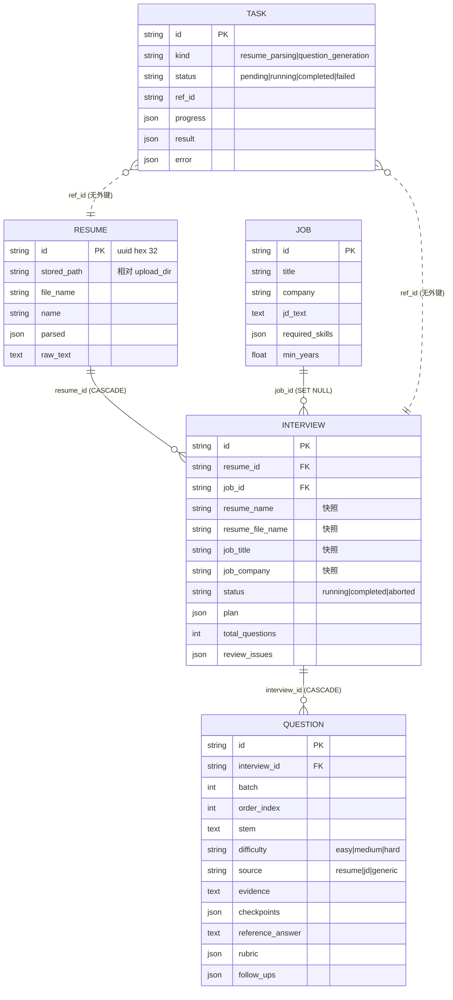

# 05 · 持久化层：模型、仓储、迁移

技术选型：**SQLAlchemy 2.x async + SQLite（aiosqlite）+ Alembic**。业务库
`data/interview_forge.db` 与 checkpoint 库 `data/checkpoints.db` 分离。

## 1. 数据模型

### 1.1 实体关系



四个业务表 + 一个任务表。**没有 `relationship()`**，跨表读取由 repository 显式 join。

### 1.2 基类：[`app/models/base.py`](file:///d:/code/InterviewForge/app/models/base.py)

| 组件 | 作用 |
| --- | --- |
| `NAMING_CONVENTION` | 让 Alembic 生成的约束名可预期（SQLite 不支持重命名约束） |
| `utcnow_naive()` | 存 naive UTC；SQLite `DateTime` 不存时区 |
| `Base` | `DeclarativeBase` + 统一 `MetaData` |
| `PrimaryKeyMixin` | `String(32)` uuid4 hex 主键（Python 侧默认） |
| `TimestampMixin` | `created_at` / `updated_at`（Python 侧默认，避免 `MissingGreenlet`） |
| `ORMModel` | 业务表公共形状；`column_names()` 提供排序白名单 |
| `__tablename__` | 每个模型显式写死 |

### 1.3 各表要点

**`resume`** — `parsed` 整份 JSON 存（不拆子表，字段集还在变、只整取整放）；
`raw_text` 是 validate/回放/录制 fixture 的唯一真相源；`stored_path` **相对** `upload_dir`，
不存绝对路径。

**`job`** — `jd_text` 与 `required_skills` 分开存（前者回溯出处，后者避免每次 match 重抽）；
自然键 `UniqueConstraint("title","company")`；`min_years=0.0` 表示不限。

**`interview`** — 报告头。四个快照列（`resume_name/resume_file_name/job_title/job_company`）
在 `start_generation` 写死，之后**不回写**；`status` 三值由 DB `CHECK` 约束；
`plan` 与 `review_issues` 整份 JSON。`job_id` 是 `ON DELETE SET NULL`（岗位下线不带走卷子），
`resume_id` 是 `ON DELETE CASCADE`（删除简历默认 409，`force=true` 才传播）。

**`question`** — 列与 `QuestionSchema` 对齐；不存分数。`UNIQUE(interview_id, batch,
order_index)` 是幂等兜底；`difficulty` / `source` 双 `CHECK`（DB 是最后边界）。
`batch` / `order_index` 在 ADR-0015 后正常恒为 1 和递增序号，但**休眠机制不许顺手删**。

**`task`** — 后台任务进度。`kind` 两种、`status` 四态（均有 CHECK）；`ref_id` 不挂外键，
因为它要活得比业务行长且两种 kind 指向两张表；`progress/result/error` 用 JSON
（形状由任务自己定）。

### 1.4 模型登记

[`app/models/__init__.py`](file:///d:/code/InterviewForge/app/models/__init__.py) 必须 import 每个模型，
否则 Alembic autogenerate 会生成「没有表」的空迁移，而它照样 upgrade 成功。

---

## 2. 仓储层

### 2.1 泛型基类：[`BaseRepository[ModelT]`](file:///d:/code/InterviewForge/app/repositories/base.py)

| 方法 | 行为 |
| --- | --- |
| `get_by_id(id_)` | `session.get`；找不到返回 `None`（404 是 API 语义） |
| `list(*, limit=50, offset=0, order_by="created_at", desc=True, filters=())` | `order_by` 必须先过 `column_names()` 白名单；`filters` 收 SQL 条件 |
| `count(*, filters=())` | 计数 |
| `create(**values)` | `add` + `flush`（拿到 Python 默认值、提前暴露约束错误） |
| `update(id_, **values)` | 逐列校验列名，`setattr` + `flush`；`updated_at` 自动盖 |
| `delete(id_)` | 删 + `flush`，返回是否真删了 |

四条铁律：**不 commit**、**找不到返回 None**、**order_by 白名单**、**只返回 ORM 实例**。

### 2.2 子类扩展

| 仓储 | 额外方法 |
| --- | --- |
| `ResumeRepository` | `get_by_stored_path(stored_path)`（seed/上传重放判重） |
| `JobRepository` | `get_by_title_and_company(title, company)`（自然键镜像） |
| `InterviewRepository` | `list_for_resume(resume_id)`、`set_status(id, status)`（三值校验） |
| `QuestionRepository` | `latest_batch(interview_id)`、`list_for_interview(id, *, batch=None)`、`add_many(rows, *, interview_id, batch)` |
| `TaskRepository` | `set_status`、`append_step(id, step)`（读-改-写 JSON）、`finish(id, status, *, result, error)` |

`list_for_interview` 的 `batch=None` 是「最新批次」，不是「全部批次」——混批会让人以为
生成了 2N 道题。

---

## 3. 引擎、会话与事务

[`app/utils/db.py`](file:///d:/code/InterviewForge/app/utils/db.py)

### 3.1 SQLite 的三条 PRAGMA（connect 事件里发）

```sql
PRAGMA foreign_keys=ON;      -- 否则 ON DELETE CASCADE 静默失效
PRAGMA busy_timeout=5000;    -- 默认 0 会立刻 database is locked
PRAGMA journal_mode=WAL;     -- 读写并发
```

### 3.2 其他取舍

- `build_engine()` 拒绝 `:memory:`（每连接一份库，测试会「刚写入就查不到」）。
- 相对路径数据库先 `mkdir` 父目录，否则首次迁移报 `unable to open database file`。
- `build_sessionmaker()`：`expire_on_commit=False` + `autoflush=False`
  （异步下懒加载会 `MissingGreenlet`）。
- `session_scope(sessionmaker)`：正常退出 `commit`，异常 `rollback` 后原样抛出。
- `build_sync_engine()`：只给 Alembic 用，把 `sqlite+aiosqlite` 降级成 `sqlite`。

### 3.3 提交时机归谁

| 场景 | 提交者 |
| --- | --- |
| HTTP 纯读/同步写 | `get_db`（请求依赖收尾） |
| 会唤起 `BackgroundTasks` 的写端点 | 服务层 `session_scope`（`accept_upload` / `start_generation`） |
| 后台任务进度 | 每次一个小事务（`task_service`） |
| 报告收尾 | `persist_report` 一个跨表大事务 |
| 脚本 | `session_scope` |

---

## 4. 迁移

```
migrations/
├── env.py                              # 同步引擎 + Base.metadata + URL 解析
└── versions/
    ├── 2056a1287299_initial_tables.py  # resume / job / interview / question
    ├── f73e2c144737_add_task_table.py   # task 表（M6）
    └── 2fe4f8fcb3c6_add_interview_resume_job_snapshot_.py  # 四个快照列（ADR-0013）
```

### 4.1 `migrations/env.py`

- URL 优先级：`ALEMBIC_DATABASE_URL` > `get_settings().database_url`；`alembic.ini` 里
  `sqlalchemy.url` 故意留空（文件进版本库，不能写连接串）。
- `target_metadata = Base.metadata`，且 import `app.models`（触发登记）。
- `render_as_batch=True`（SQLite 不支持 `ALTER COLUMN`），但**写迁移时禁止
  `op.batch_alter_table`**：它会建临时表 + `DROP TABLE`，而 `PRAGMA foreign_keys=ON`
  会触发 `question.interview_id` 的级联删除（实测删空过 30 行题目）。
- 新列一律裸 `ALTER TABLE … ADD COLUMN … NOT NULL DEFAULT ''`，模型同步写
  `server_default=text("''")`，否则 `alembic check` 报漂移。

### 4.2 `alembic.ini`

**必须保持 ASCII**：alembic 用 `ConfigParser.read(..., encoding="locale")`，本机 locale 是
GBK，中文注释会在迁移执行前抛 `UnicodeDecodeError`。说明文字放 `migrations/env.py` / ADR。

### 4.3 常用命令

```bash
PYTHONPATH=. .venv/Scripts/python.exe -X utf8 -m alembic upgrade head
PYTHONPATH=. .venv/Scripts/python.exe -X utf8 -m alembic check
PYTHONPATH=. .venv/Scripts/python.exe -X utf8 -m alembic upgrade head --sql   # 只看 SQL
```

---

## 5. 数据文件布局

```
data/
├── interview_forge.db     # 业务库（resume/job/interview/question/task）
├── checkpoints.db         # LangGraph AsyncSqliteSaver checkpoint
└── uploads/               # 简历原件，命名 {resume_id}{suffix}
```

- checkpoint 独立成库：图状态与业务数据生命周期不同，混在一起会让「清库重跑」变成两难。
- `uploads/` 的文件名只由 `resume_id` 构造，用户文件名不参与路径。
- 删简历时文件在行删除**之后**删且忽略失败（`_remove_quietly`），避免「库里有、盘上没有」。

## 6. 测试

- 每个用例一个 `tmp_path` 下的临时文件库（`tests/conftest.py` 的 `db_url / engine / session /
  db_sessionmaker`）。
- 建表走 `Base.metadata.create_all`；迁移本身只在 `tests/test_migrations.py` 用**真子进程**
  跑 `upgrade / downgrade / check`。
- 绝不碰 `data/interview_forge.db`，也不用 `:memory:`。
