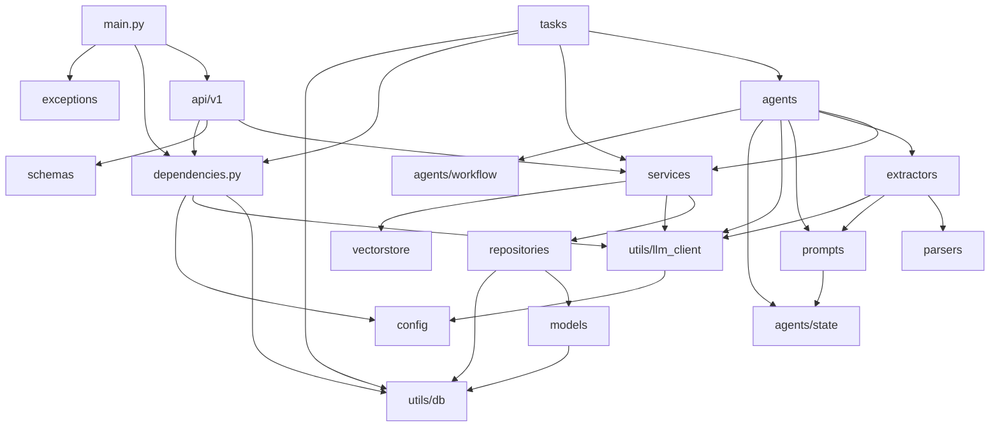

# 10 · 依赖关系与速查

## 1. 分层依赖规则

```
app/api        → app/services, app/schemas, app/repositories, app/dependencies
app/tasks      → app/agents, app/services, app/repositories, app/dependencies
app/services   → app/repositories, app/schemas, app/utils, app/exceptions
app/agents     → app/services, app/extractors, app/parsers, app/prompts, app/utils, app/exceptions
app/extractors → app/parsers, app/prompts, app/utils, app/schemas
app/repositories → app/models, app/utils
app/models     → app/utils (Base)
app/vectorstore→ app/utils, app/exceptions
app/api        ✗ app/models（API 不 import ORM）
app/services   ✗ SQL（不写 select/insert）
app/agents     ✗ 数据库（节点不直连；落库经 review_service）
任意层         ✗ 自行 new LLMClient（必须装配期注入）
```

## 2. 模块依赖图



## 3. 关键文件速查

| 想改什么 | 去哪个文件 | 同时注意 |
| --- | --- | --- |
| 启动/路由挂载/CORS/静态托管 | `app/main.py` | 静态必须在 `include_router` 之后 |
| 环境变量/行为参数 | `app/config.py` + `configs/*.yaml` | 三份 yaml 同步；yaml 只允许五段 |
| 引擎/会话/LLM 依赖 | `app/dependencies.py` | 引擎单例、LLM 每请求新建 |
| 图的结构/回退边/扇出 | `app/agents/workflow.py` | 回退用 `<=`；`GenerateJob` 字段要全 |
| State 通道 | `app/agents/state.py` | 只追加通道半开 reducer；`PromptTrace` 字段 |
| 解析节点 | `app/agents/nodes/parse_node.py` | 文件类型分支、年限对账 |
| 校验规则 | `app/services/resume_service.validate_resume` + `validate_node` | 规则先于 LLM；回退计数自增 |
| JD 匹配 | `app/services/match_service.py` + `match_node` | 词典优先；模型只判 `unresolved` |
| 评分/主题 | `app/services/profile_service.py` + `profile_node` | 分数由 rubric；叙述过实体闸门 |
| 配额 | `app/agents/nodes/plan_node.py` | 最大余数法；`source` 三档 |
| 出题 | `app/agents/nodes/generate_node.py` + `question_service` | 扇出载荷、引用核对、工序号 |
| 评审/落库 | `app/agents/nodes/review_node.py` + `review_service` | 不拦门；`persist_report` 唯一出口 |
| 简历/岗位 CRUD | `app/services/{resume,job}_service.py` | 409 先查后插；快照不回写 |
| API 出入参 | `app/schemas/` | 前端 `src/api/types.ts` 同步 |
| 文件解析 | `app/parsers/` | 读不出文本必须抛 `ParseError` |
| 抽取规则/词表 | `app/extractors/` | 无证据即丢弃；词典外只记提示 |
| 报告落库 SQL | `app/repositories/` | 只 `flush`；`order_by` 白名单 |
| 表结构 | `app/models/` + `migrations/versions/` | 登记 `models/__init__.py`；禁 `batch_alter_table` |
| 错误码 | `app/exceptions/` | `details` 不含密钥/原文 |
| 后台任务 | `app/tasks/` | 状态机 + `mark_failed` 兜底 |
| Prompt | `app/prompts/templates/v1/` | `StrictUndefined`；版本号进 trace |
| 前端页面 | `frontend/src/views/` | 只读 `dist/`；`npm run typecheck` |
| 前端请求 | `frontend/src/api/index.ts` | 与 `types.ts` 同步 |
| 任务轮询 | `frontend/src/utils/task.ts` | 可取消；2 秒间隔 |

## 4. 运行时对象生命周期

| 对象 | 生命周期 | 创建点 | 销毁点 |
| --- | --- | --- | --- |
| `Settings` | 进程（lru_cache） | `get_settings()` | — |
| `AsyncEngine` | 进程（按 URL 缓存） | `get_engine()` | lifespan `dispose_engine()` |
| `async_sessionmaker` | 进程（薄封装） | `get_sessionmaker()` / `get_db` | — |
| `AsyncSession` | 每请求 / 每 `session_scope` | `get_db` | 依赖收尾 commit/rollback |
| `LLMClient` | 每请求（HTTP 侧）/ 每后台任务 | `get_llm()` / `make_live_nodes()` | 依赖 `finally` `aclose()`；后台任务关自建的那个（T-011） |
| `AsyncSqliteSaver` | 每次生成任务 | `open_checkpointer()` | 任务退出 |
| `AgentGraph` | 每次生成任务（编译一次） | `build_agent_graph()` | GC |
| Pinia store | 页面会话 | `useAppStore()` | — |
| 任务轮询器 | 页面/操作生命周期 | `createTaskPoller()` | `stop()` |

## 5. 一次「生成报告」的模块调用链

```
POST /interviews/generate
  api/v1/interviews.py
    interview_service.start_generation          # 建 interview 快照 + task，commit
    BackgroundTasks.add_task(run_question_generation)
  tasks/question_generation.py
    task_service.mark_running
    open_checkpointer → build_agent_graph(make_live_nodes)
    graph.astream(state, stream_mode="updates")
      parse_node → extractors/parsers/prompts/llm_client
      validate_node → resume_service.validate_resume + llm
      match_node → match_service.build_match + llm
      profile_node → profile_service + llm
      plan_node → 纯规则
      generate_node → guardrails(budget) + Overwrite([])
      generate_item ×N → question_service.adopt_questions + llm
      review_node → review_service.rule_issues/adopt_model_issues
                    review_service.persist_report（唯一落库）
    _record_updates → task_service.record_step
    task_service.mark_completed / mark_failed + _abort_interview
GET /interviews/{id}
  interview_service.fetch_report → InterviewOut
```

## 6. 数据所有权（谁说了算）

| 事实 | 唯一真相源 | 派生/副本 |
| --- | --- | --- |
| 简历原文与解析结果 | `resume.raw_text` / `resume.parsed` | — |
| 岗位 JD 与技能 | `job.jd_text` / `job.required_skills` | 报告里的快照列（历史值，不回写） |
| 报告头身份 | `interview.*` 四个快照列 | 列表/详情直接读，不回 join 源表 |
| 题目 | `question` 表（`batch + order_index` 唯一） | 前端筛选只是视图 |
| 任务进度 | `task.progress` | 前端轮询展示 |
| 图状态 | `data/checkpoints.db` | `task.result` 只是摘要 |
| 校验问题 | `validate_issues`（驱动路由） | — |
| 纯观测流水账 | `errors` / `trace` | — |
| 评审批注 | `interview.review_issues` | 不驱动路由（ADR-0015） |

## 7. 向量检索现状（seam 而非实现）

`app/vectorstore/`：

| 文件 | 状态 |
| --- | --- |
| `retriever.py` | **已接线**：`SkillRetriever` Protocol + `NullRetriever`（恒返回空） |
| `client.py` / `job_indexer.py` / `question_dedup.py` | 预留/壳；embedding 未选型（`docs/TODO.md` §3） |

`match_node` 只认 `SkillRetriever`，默认 `NullRetriever`；接 sqlite-vec 时新增实现类并在
`make_match_node(retriever=...)` 注入即可，节点代码不动。**不要**在 `NullRetriever` 里塞
正则当「简易检索」——那会让将来召回率变化无法归因。

## 8. 文档与代码的对应

| 文档 | 对应代码 |
| --- | --- |
| `docs/LANGGRAPH_BUILD_PLAN.md` | 节点契约、里程碑验收（§ 编号被 docstring 引用） |
| `docs/adr/0007` | 持久化层（repository / session_scope） |
| `docs/adr/0010` | M5 扇出形状（质量门一节被 0015 取代） |
| `docs/adr/0011` | 后台化与任务进度 |
| `docs/adr/0013` | 岗位/简历写入侧与报告快照列 |
| `docs/adr/0014` | 岗位图片录入草稿·确认两步 |
| `docs/adr/0015` | 评审退回为纯批注、「一次成卷」 |
| `docs/adr/0016` | Vue 3 控制台与 SPA 回退 |
| `AGENTS.md` | 分层铁律、节点契约、测试策略（本 Wiki 的上位约束） |
